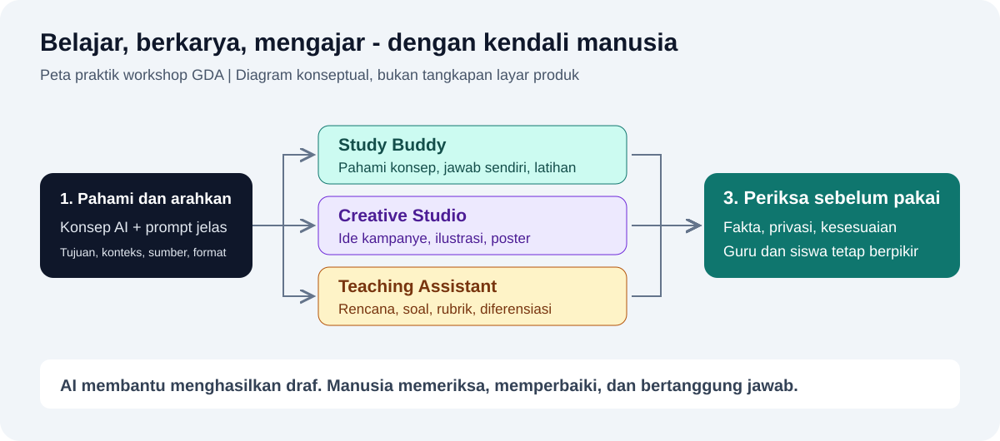

# Workshop GDA: AI untuk Belajar dan Mengajar

Materi pendamping workshop **Global Darussalam Academy, Yogyakarta** untuk siswa, guru, dan pengelola sekolah. Tujuannya bukan menyerahkan proses berpikir kepada AI, tetapi belajar menggunakan AI dengan terarah, kreatif, dan bertanggung jawab.

**Versi panduan: 8 November 2026.** Penjelasan berbahasa Indonesia; presentasi asli berbahasa Inggris. Panduan disusun berdasarkan presentasi dan sumber resmi Microsoft Learn, Microsoft Support, Microsoft Education, serta Microsoft News. GitHub Docs digunakan khusus untuk GitHub Education.

## Mulai dari sini

1. **[Buka atau unduh presentasi PDF](materi/AI-for-Learning-and-Teaching-GDA.pdf)** — 36 halaman. Di GitHub, gunakan tombol unduh pada halaman file.
2. Baca [konsep AI dan penggunaan yang bertanggung jawab](panduan/01-konsep-ai.md).
3. Ikuti [tutorial tiga praktik utama](panduan/02-tutorial-praktik.md), termasuk prompt yang bisa langsung disalin.
4. Pelajari [demo multi-agent di Copilot Studio](panduan/03-demo-multi-agent.md) jika memiliki akses organisasi.
5. Lanjutkan melalui [program pendidikan dan peta belajar](panduan/04-belajar-lanjutan.md).
6. Gunakan [daftar sumber resmi](panduan/05-sumber-resmi.md) untuk memeriksa informasi terbaru.

> Repository ini membagikan **PDF, bukan PPT/PPTX**. PDF merupakan ekspor presentasi sumber, bukan versi yang didesain ulang. Panduan melengkapi penjelasan dan memberi catatan tentang batasan, perubahan antarmuka, serta syarat layanan.

## Apa yang akan dihasilkan?

| Praktik | Peserta utama | Alat | Hasil yang dikumpulkan |
|---|---|---|---|
| AI Study Buddy | Siswa | Microsoft Copilot; Learn jika tersedia | Catatan konsep, latihan lima soal, refleksi |
| AI Creative Studio | Siswa dan guru | Microsoft Copilot + Microsoft Designer | Poster, prompt awal dan revisi, keterangan penggunaan AI |
| AI Teaching Assistant | Guru | Microsoft Copilot | Rencana pembelajaran, sepuluh soal, kunci, rubrik, diferensiasi |
| Demo Sahabat Belajar | Fasilitator/guru dengan akses | Microsoft Copilot Studio | Paket pembelajaran pecahan dari coordinator dan tiga child agent |

Semua hasil AI harus diperiksa. Hasil yang tampak rapi belum tentu benar atau sesuai kebutuhan siswa.

## Persiapan singkat

- Laptop atau ponsel, browser terbaru, dan koneksi internet.
- Akun Microsoft pribadi untuk jalur praktik personal, **jika peserta memenuhi syarat usia dan kebijakan sekolah**.
- Buka [Microsoft Copilot](https://copilot.microsoft.com/) dan [Microsoft Designer](https://designer.microsoft.com/).
- Siapkan materi pendek yang boleh dibagikan dan sudah bebas data pribadi. Tutorial juga menyediakan teks latihan.
- Copilot Studio memerlukan akun kerja/sekolah, izin lingkungan, serta lisensi atau trial yang sesuai. Ini **bukan** fitur akun pribadi gratis.
- Jangan membeli langganan atau mengaktifkan layanan berbayar hanya untuk mengikuti tiga praktik dasar ini.

**Penting untuk peserta usia sekolah:** Copilot personal memiliki batas usia minimum 13 tahun, yang dapat lebih tinggi menurut wilayah. Fitur AI Designer memiliki batas usia tersendiri menurut wilayah. Jika akses ditolak, jangan mengubah tanggal lahir atau berbagi akun. Gunakan demonstrasi oleh fasilitator dewasa dan kegiatan menulis prompt di luar aplikasi. Detail: [akun dan keselamatan](panduan/02-tutorial-praktik.md#1-persiapan-akun-dan-keselamatan).

## Alur sesi yang disarankan

Ini contoh agenda fasilitator, bukan durasi wajib atau ketentuan Microsoft.

| Waktu | Kegiatan |
|---|---|
| 10 menit | Persiapan akun dan aturan keselamatan |
| 20 menit | Konsep AI dan latihan prompt |
| 25 menit | Study Buddy |
| 25 menit | Creative Studio |
| 20 menit | Teaching Assistant |
| 15 menit | Demo multi-agent dan aksesibilitas |
| 5 menit | Refleksi dan langkah belajar berikutnya |
| **120 menit** | **Total** |

## Cara membaca materi di GitHub

- Klik judul dokumen; tidak perlu memasang Git atau aplikasi pemrograman.
- Salin isi blok prompt, lalu tempel ke kolom chat Copilot.
- Gunakan **Code > Download ZIP** untuk menyimpan seluruh paket; ekstrak ZIP sebelum membuka file.
- Diagram Mermaid tampil pada halaman Markdown GitHub. Untuk pembaca yang tidak mendukung Mermaid, penjelasan teks tetap tersedia.
- Dokumen pengetahuan pada folder [latihan](latihan/) dapat diunduh untuk demo Copilot Studio.

## Catatan sebelum dibagikan

Antarmuka, kuota gratis, lisensi, eligibility, dan program dapat berubah. Uji akses dengan jenis akun peserta sebelum sesi. Panduan ini bukan jaminan semua fitur tersedia untuk semua akun dan bukan dokumen kebijakan resmi Microsoft. Contoh prompt, rubrik, dan bahan latihan ditulis untuk workshop; tidak disalin dari buku berhak cipta. Rujukan resmi tetap menjadi acuan untuk ketentuan produk.
