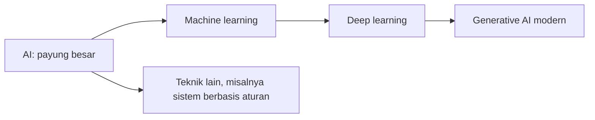
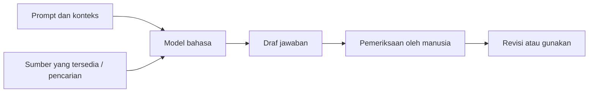

# 1. Memahami AI sebelum mulai praktik

[Kembali ke awal](../README.md) | [Lanjut ke tutorial](02-tutorial-praktik.md)

Bagian ini mendampingi slide 3-10 dan 25-28 dalam [presentasi PDF](../materi/AI-for-Learning-and-Teaching-GDA.pdf). Setelah membaca, peserta diharapkan dapat menjelaskan kemampuan dan batasan AI, menyusun prompt yang jelas, dan memeriksa hasilnya.

## 1. AI, machine learning, deep learning, dan generative AI

| Istilah | Penjelasan sederhana | Contoh |
|---|---|---|
| Artificial intelligence / AI | Kelompok teknik untuk menjalankan tugas yang memerlukan kemampuan seperti mengenali pola, memahami bahasa, atau membuat keputusan | Pengenalan suara, rekomendasi, chatbot |
| Machine learning / ML | Teknik AI yang mempelajari pola dari data, bukan hanya mengikuti daftar aturan yang ditulis manusia | Model memprediksi kategori gambar |
| Deep learning | Bagian ML yang menggunakan jaringan saraf berlapis | Mengenali objek atau pola bahasa |
| Generative AI | AI yang menghasilkan konten baru dari instruksi dan konteks | Draf penjelasan, ilustrasi, soal latihan |
| Large language model / LLM | Model bahasa berskala besar yang dapat memproses dan menghasilkan teks | Model yang mendukung percakapan Copilot |

Diagram berikut adalah penyederhanaan untuk menjelaskan keluarga teknik. Sebagian besar generative AI modern memakai deep learning; tidak semua AI merupakan generative AI.



**Catatan tentang timeline slide:** tahun pada slide adalah ilustrasi tonggak perkembangan, bukan tahun penemuan resmi setiap bidang. Deep learning tidak baru ditemukan pada 2017, dan generative AI tidak baru muncul pada 2021. Jangan menghafalkan angka itu sebagai definisi.

Rujukan: [R01 - AI Fluency](05-sumber-resmi.md#r01-ai-fluency) dan [R02 - AI for educators](05-sumber-resmi.md#r02-ai-for-educators).

## 2. Bagaimana LLM menyusun jawaban?

Secara sederhana, model:

1. Mempelajari pola dari data saat pelatihan.
2. Menerima prompt, riwayat percakapan yang tersedia, dan konteks tambahan.
3. Menghasilkan jawaban bertahap dalam unit yang disebut **token**. Token dapat berupa bagian kata, kata, atau tanda baca.
4. Dalam produk tertentu, menggunakan pencarian atau alat lain untuk memperoleh informasi tambahan.



Model tidak membaca pikiran kita. Instruksi "buat materi bagus" kurang membantu dibanding instruksi yang menyebut topik, usia siswa, tujuan, sumber, dan format.

**Mengapa jawaban bisa salah?** Model dapat menghasilkan pernyataan yang terdengar meyakinkan, tetapi tidak didukung sumber. Ini sering disebut *hallucination*. Contohnya: tanggal sejarah salah, referensi buku tidak nyata, atau kunci soal matematika keliru.

Meminta "jawaban harus benar" tidak menghapus risiko ini. Bahkan ketika ada sitasi, buka sumbernya dan pastikan sumber tersebut benar-benar mendukung klaim.

Rujukan: [R03 - Get started with Microsoft Copilot](05-sumber-resmi.md#r03-get-started-with-microsoft-copilot) dan [R06 - Copilot for young people](05-sumber-resmi.md#r06-copilot-for-young-people).

## 3. Mengapa data disebut bahan bakar AI?

Data memengaruhi apa yang dipelajari model dan konteks yang dipakai saat menjawab. Dalam pembelajaran, **materi rujukan yang tepat lebih penting daripada sekadar materi yang banyak**.

Contoh:

- Jika guru memberikan bahan yang jelas tentang pecahan, AI lebih mudah membuat latihan yang sesuai.
- Jika bahan berisi kesalahan atau tidak sesuai jenjang, jawaban AI juga dapat menyesatkan.
- Mengunggah dokumen ke chat tidak sama dengan melatih ulang model secara langsung. Penggunaan dan penyimpanan data mengikuti kebijakan layanan dan jenis akun.
- Dokumen privat tidak otomatis menjadi aman hanya karena dipakai untuk tugas sekolah.

Untuk workshop, gunakan teks latihan yang tersedia atau materi yang memang diizinkan. Jangan mengunggah daftar siswa, nilai individual, identitas, foto anak, informasi kesehatan, kata sandi, atau dokumen rahasia.

## 4. Empat unsur prompt yang efektif

Microsoft menjelaskan empat unsur: **Goal, Context, Source, Expectations**. Tidak setiap prompt harus memuat semuanya, tetapi unsur ini membantu memperjelas kebutuhan.

| Unsur | Pertanyaan | Contoh |
|---|---|---|
| Goal / tujuan | Apa yang ingin dibuat? | Lima soal latihan |
| Context / konteks | Untuk siapa dan dalam situasi apa? | Kelas 8 yang baru belajar Pythagoras |
| Source / sumber | Berdasarkan bahan apa? | Ringkasan yang ditempel di chat |
| Expectations / harapan | Bentuk dan batasan hasil? | Tabel, kunci, penjelasan, bahasa Indonesia |

Contoh prompt:

```text
Buat lima soal latihan teorema Pythagoras untuk siswa kelas 8
yang baru mempelajari segitiga siku-siku.
Gunakan ringkasan materi yang saya tempel di bawah sebagai sumber.
Sajikan dalam tabel: nomor, soal, kunci, dan penjelasan.
Gunakan bahasa Indonesia sederhana.
Jika ada informasi yang tidak tersedia dalam ringkasan, jelaskan
keterbatasannya dan jangan membuat rujukan palsu.
```

**Latihan dua menit:** ubah "jelaskan fotosintesis" menjadi prompt yang mencantumkan empat unsur. Tukar dengan teman; minta teman menunjukkan bagian yang masih ambigu.

Rujukan: [R05 - Panduan menulis prompt](05-sumber-resmi.md#r05-panduan-menulis-prompt).

## 5. Chatbot, agent, dan multi-agent

| Bentuk | Karakteristik | Contoh di sekolah |
|---|---|---|
| Chat tanpa agent khusus | Membantu tugas yang sempit melalui percakapan | Menyederhanakan paragraf |
| Satu agent | Memiliki tujuan, instruksi, pengetahuan, dan mungkin alat | Tutor pecahan |
| Multi-agent | Beberapa agent dengan tugas berbeda bekerja melalui koordinasi | Tutor + perencana pelajaran + pembuat kuis |

Agent bukan manusia dan tidak otomatis benar. Agent juga tidak harus menjalankan tindakan mandiri; desain yang aman dapat membatasi agent hanya menghasilkan draf untuk diperiksa guru.

Dalam workshop, coordinator **Sahabat Belajar** membagi kebutuhan ke tiga spesialis. Penjelasan dan tutorial: [demo multi-agent](03-demo-multi-agent.md).

Timeline "wave" pada slide 8 adalah gambaran pola adopsi, bukan jaminan semua organisasi melalui urutan yang sama atau bahwa AGI sudah tersedia. Sistem multi-agent bukan bukti tercapainya AGI.

Rujukan: [R08 - Generative orchestration](05-sumber-resmi.md#r08-generative-orchestration) dan [R09 - Child agents](05-sumber-resmi.md#r09-child-agents).

## 6. Empat kebiasaan yang harus dibawa pulang

1. **Berpikir sendiri.** Coba menjawab dahulu; gunakan AI untuk petunjuk dan umpan balik.
2. **Periksa fakta.** Cocokkan dengan buku, sumber resmi, atau perhitungan mandiri.
3. **Jujur tentang bantuan AI.** Jelaskan bagian yang dibantu AI dan bagian yang direvisi sendiri.
4. **Manusia tetap meninjau.** Guru memeriksa materi, kunci, rubrik, dan kesesuaian pembelajaran.

Contoh pernyataan penggunaan:

> Saya menggunakan Microsoft Copilot untuk membuat draf pertanyaan dan Microsoft Designer untuk ilustrasi. Saya memilih hasil, memeriksa isi, dan memperbaiki judul serta tata letak secara mandiri.

Jangan menyatakan hasil AI sebagai foto kejadian nyata, bukti ilmiah, keputusan penilaian final, atau diagnosis. Jangan meminta AI meniru identitas orang lain untuk menipu.

## 7. AI untuk aksesibilitas

Slide 27-28 memberi contoh inovasi dari Indonesia:

- **NeuroBuddy:** pemenang AI for Accessibility Hackathon 2025; prototipe permainan berbasis AI untuk membantu deteksi dini potensi neurodivergensi.
- **Pintaru:** buku digital adaptif yang dapat menyesuaikan ukuran huruf, spasi, dan elemen visual.
- **Yayasan Mitra Netra:** penggunaan Azure OpenAI untuk membantu konversi gambar teks Arab berharakat menjadi teks Unicode yang dapat mendukung alur aksesibilitas Braille.

Pelajaran utamanya: mulai dari kebutuhan pengguna, bukan dari kecanggihan teknologi. Teks sederhana, kontras yang cukup, caption, dan materi yang dapat dibaca screen reader sering sangat membantu.

**Batasan:** berita tentang prototipe bukan validasi medis. Jangan menggunakan chat workshop untuk menilai disleksia, ASD, ADHD, atau kondisi kesehatan peserta. Materi Braille dan hasil konversi tetap perlu diperiksa oleh pengguna serta ahli yang relevan. Klaim perluasan fitur pada tahun lain tidak otomatis terbukti oleh berita 2024.

Rujukan: [R18 - Hackathon aksesibilitas](05-sumber-resmi.md#r18-hackathon-aksesibilitas) dan [R19 - Mitra Netra](05-sumber-resmi.md#r19-mitra-netra).

## 8. Cek pemahaman

Jawab tanpa membuka Copilot:

1. Apakah semua AI menghasilkan teks atau gambar baru? **Tidak.**
2. Apakah sitasi menjamin jawaban AI benar? **Tidak; periksa sumber dan klaimnya.**
3. Apakah akun pribadi dan akun sekolah memiliki fitur serta kebijakan identik? **Tidak.**
4. Siapa yang bertanggung jawab terhadap materi yang dibagikan guru? **Guru yang meninjau dan menggunakan materi.**
5. Apakah tiga agent otomatis lebih baik daripada satu? **Tidak; manfaatnya bergantung pada kebutuhan, batas tugas, dan pengujian.**
