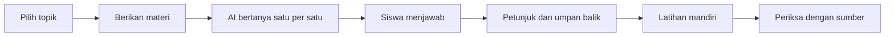

# 2. Tutorial tiga praktik utama

[Kembali ke awal](../README.md) | [Konsep AI](01-konsep-ai.md) | [Demo multi-agent](03-demo-multi-agent.md)

Mendampingi slide 13-25 dalam [presentasi PDF](../materi/AI-for-Learning-and-Teaching-GDA.pdf). Semua prompt berikut merupakan contoh workshop yang boleh disesuaikan, bukan jaminan keluaran yang persis sama.

## 1. Persiapan akun dan keselamatan

### Pilih jalur yang benar

| Jalur | Untuk apa? | Syarat dan batasan |
|---|---|---|
| Copilot personal | Tiga latihan berbasis chat | Akun Microsoft pribadi; fitur dan kuota bervariasi |
| Designer personal | Ilustrasi dan poster latihan nonkomersial | Akun pribadi; kuota gratis dan batas usia fitur AI menurut wilayah |
| Copilot akun sekolah | Penggunaan yang dikelola sekolah | Akun organisasi, kebijakan admin, eligibility dan lisensi terkait |
| Copilot Studio | Demo membangun tim agent | Akun kerja/sekolah dan akses lingkungan; lisensi/trial yang sesuai |

**Jangan menyamakan** Copilot personal, Microsoft 365 Copilot Chat, fitur Teach/Study/Learn untuk pendidikan, dan Copilot Studio. Nama fitur yang mirip tidak berarti aksesnya sama. Tiga praktik di bawah tidak mengharuskan peserta memiliki Microsoft 365 Copilot berbayar.

### Langkah sebelum latihan

1. Buka [Copilot](https://copilot.microsoft.com/). Slide memakai alamat `copilot.cloud.microsoft`; jika diarahkan ke pengalaman organisasi, gunakan halaman masuk personal dan periksa jenis akun.
2. Pilih **Sign in / Masuk**, lalu gunakan akun yang sudah disetujui untuk kegiatan. Jangan menuliskan kata sandi dalam chat AI.
3. Periksa profil. Jika muncul pilihan **Personal** dan **Work or school**, jangan memilih akun organisasi secara tidak sengaja untuk latihan personal.
4. Buka [Designer](https://designer.microsoft.com/) dan pastikan peserta dapat masuk.
5. Kirim prompt sederhana: "Jelaskan apa itu segitiga siku-siku dalam dua kalimat bahasa Indonesia."
6. Jika akun tidak bisa dipakai karena usia, kebijakan, atau izin, catat kendalanya. Ikuti demonstrasi fasilitator, bukan memalsukan usia atau memakai akun bersama.

**Usia dan pendampingan:** Copilot personal mensyaratkan setidaknya 13 tahun; minimum dapat lebih tinggi menurut negara/wilayah. Designer memiliki persyaratan usia fitur generative AI tersendiri. Guru/orang tua tetap mengawasi penggunaan sesuai kebijakan sekolah. Untuk anak yang belum memenuhi syarat, fasilitator dewasa dapat mendemonstrasikan hasil di layar kelas; peserta menulis dan mengevaluasi prompt tanpa mengakses layanan sendiri.

**Privasi:** gunakan contoh anonim. Jangan unggah nilai siswa, identitas, foto anak, informasi kesehatan, nomor telepon, alamat, kredensial, atau dokumen internal sekolah. Jika menggunakan perangkat bersama, jangan simpan kata sandi; keluar dari akun setelah sesi.

Rujukan: [R04 - Akun dan navigasi](05-sumber-resmi.md#r04-akun-dan-navigasi), [R06 - Copilot for young people](05-sumber-resmi.md#r06-copilot-for-young-people), [R07 - Designer FAQ](05-sumber-resmi.md#r07-designer-faq).

### Bila tampilan berbeda dengan slide

Slide menunjukkan **More > Learn > Guided learning**, **Quiz**, **Flashcards**, dan pembuatan dokumen melalui Learn. Gunakan jalur itu **hanya jika tersedia pada akun Anda**. Menu bisa berubah menurut jenis akun, usia, wilayah, atau peluncuran fitur.

Panduan ini tidak menganggap menu Learn tersedia untuk setiap akun. Dasar yang diverifikasi pada sumber resmi adalah penggunaan Copilot personal dan prompt; langkah chat di bawah menjadi jalur yang dapat dicoba tanpa bergantung pada menu tersebut. Kuis dan flashcards yang diminta lewat chat adalah keluaran percakapan, **bukan** jaminan antarmuka kuis interaktif, pelacakan progres, atau kartu yang dapat dibalik.

## 2. Demo 1 - AI Study Buddy

**Tujuan:** memahami konsep dengan pertanyaan bertahap, bukan menyalin jawaban.

**Alokasi:** sekitar 25 menit.

**Hasil:** penjelasan sendiri, lima soal latihan, dan satu refleksi.



### A. Siapkan materi latihan

Gunakan topik **fotosintesis**. Teks berikut ditulis untuk workshop, bukan kutipan buku. Guru tetap dapat menggantinya dengan bahan ajar yang sudah diperiksa.

```text
Materi latihan:
Fotosintesis adalah proses pada tumbuhan hijau untuk membentuk
gula dari karbon dioksida dan air dengan bantuan energi cahaya.
Klorofil membantu menangkap energi cahaya. Pada tumbuhan, proses
ini berlangsung di kloroplas. Oksigen dilepaskan sebagai salah satu
hasil proses. Air diserap melalui akar dan karbon dioksida masuk
terutama melalui stomata pada daun.
Tumbuhan juga melakukan respirasi; fotosintesis dan respirasi
bukan proses yang sama.
```

Jika tersedia unggah file, gunakan hanya file yang boleh dibagikan. Jika tidak tersedia, cukup tempel teks ini di chat.

### B. Mulai percakapan terpandu

1. Mulai chat baru. Jika ada **Learn > Guided learning**, Anda boleh memilihnya.
2. Tempel teks materi dan prompt berikut dalam pesan yang sama.
3. Jawab pertanyaan pertama dengan kata-kata sendiri.
4. Jika belum tahu, tulis "Beri satu petunjuk, jangan langsung jawab."
5. Lanjutkan sampai paling sedikit tiga pertanyaan terjawab.

```text
Jadilah tutor belajar fotosintesis untuk siswa SMP.
Gunakan materi latihan di atas sebagai sumber utama.
Bimbing dengan metode Socratic: ajukan hanya satu pertanyaan
setiap kali, tunggu jawaban saya, lalu beri umpan balik.
Jika jawaban saya salah, beri satu petunjuk lebih dahulu.
Jangan langsung menampilkan seluruh jawaban.
Gunakan bahasa Indonesia sederhana.
Setelah saya memahami konsep, tawarkan latihan lima soal.
```

Contoh respons siswa yang baik: "Menurut saya tumbuhan memakai cahaya sebagai sumber energi, bukan memakan cahaya secara langsung."

### C. Uji pemahaman

```text
Buat lima soal tentang materi fotosintesis tadi.
Ajukan satu per satu tanpa menampilkan kunci terlebih dahulu.
Setelah saya menjawab semua soal, jelaskan jawaban yang salah
dan tunjukkan bagian materi yang perlu saya baca kembali.
```

Jika menu **Quiz** tersedia, gunakan sebagai alternatif dan periksa penjelasannya. Jangan menganggap skor AI sama dengan nilai resmi sekolah.

### D. Buat flashcards dan refleksi

```text
Buat enam flashcards dari materi tadi dalam tabel dua kolom:
Pertanyaan di depan dan Jawaban di belakang.
Gunakan jawaban singkat, maksimal dua kalimat per kartu.
```

Jika menu **Flashcards** tersedia, Anda boleh mencoba antarmukanya. Jika hanya tabel di chat, salin ke catatan atau kartu kertas.

Tulis refleksi sendiri:

- "Konsep yang sekarang saya pahami adalah ..."
- "Kesalahan saya sebelumnya adalah ..."
- "Hal yang masih perlu saya cek di buku adalah ..."

### E. Pemeriksaan dan kriteria selesai

- [ ] Saya menjawab paling sedikit tiga pertanyaan tanpa menyalin.
- [ ] Saya mencoba lima soal sebelum melihat kunci.
- [ ] Saya dapat membedakan fotosintesis dan respirasi.
- [ ] Saya memeriksa penjelasan dengan guru atau bahan ajar.
- [ ] Saya mencatat satu hal yang belum saya pahami.

Contoh miskonsepsi yang perlu diwaspadai: "Tumbuhan hanya bernapas pada malam hari." Tumbuhan melakukan respirasi siang dan malam; jangan menerima penjelasan ini jika AI menyatakannya.

Rujukan pendekatan: [R02](05-sumber-resmi.md#r02-ai-for-educators), [R05](05-sumber-resmi.md#r05-panduan-menulis-prompt), [R06](05-sumber-resmi.md#r06-copilot-for-young-people).

## 3. Demo 2 - AI Creative Studio

**Tujuan:** mengembangkan ide menjadi poster yang pesannya jelas.

**Alokasi:** sekitar 25 menit.

**Hasil:** poster latihan nonkomersial, dua versi prompt, dan keterangan bantuan AI.

### A. Kembangkan pesan bersama Copilot

```text
Bantu saya merancang poster latihan nonkomersial untuk siswa SMP
bertema "Yogyakarta Bebas Sampah Plastik".
Berikan tiga ide visual dan tiga slogan bahasa Indonesia,
masing-masing maksimal delapan kata.
Jangan menambahkan angka statistik, logo, atau klaim ilmiah
yang tidak memiliki sumber.
Targetnya: mengajak membawa botol minum dan memilah sampah.
```

Pilih satu pesan. Jangan memuat banyak ajakan berbeda dalam satu poster.

### B. Tulis prompt gambar

Rumus: **subjek + gaya + warna + suasana + ruang teks**.

```text
Ilustrasi poster vertikal untuk latihan kelas nonkomersial.
Tugu Yogyakarta dan sungai yang bersih, warga membawa botol minum
pakai ulang dan memilah sampah plastik.
Gaya ilustrasi batik modern, warna hijau dan cokelat,
suasana optimistis dan ramah.
Sisakan ruang kosong di bagian atas untuk judul.
Tanpa tulisan, tanpa logo, bukan foto dokumenter.
```

### C. Buat dan perbaiki gambar di Designer

1. Masuk ke [Designer](https://designer.microsoft.com/).
2. Pilih fitur pembuatan gambar atau desain yang tersedia, misalnya **Create images**. Nama dapat berbeda.
3. Tempel prompt.
4. Jika tersedia **Enhance prompt**, coba lalu **baca ulang hasilnya**. Ini memperkaya deskripsi prompt, bukan menjamin akurasi atau sekadar meningkatkan resolusi gambar.
5. Pilih **Generate**. Tunggu proses dan periksa pilihan gambar.
6. Pilih gambar yang paling mendukung pesan, bukan sekadar paling ramai.
7. Pilih **Edit** jika tersedia untuk membuka canvas.

Revisi dengan mengubah deskripsi dan menghasilkan ulang jika percakapan langsung tidak tersedia:

```text
Pertahankan tema dan gaya ilustrasi.
Kurangi jumlah objek agar poster lebih sederhana.
Perbesar ruang kosong di bagian atas dan gunakan kontras lebih kuat.
Jangan tambahkan tulisan di dalam ilustrasi.
```

### D. Tambahkan tulisan sebagai elemen teks

Teks yang digambar oleh AI dapat salah eja atau salah bahasa. **Judul harus menjadi elemen teks yang Anda periksa**, bukan bergantung pada tulisan di dalam ilustrasi.

1. Di canvas, pilih **Text** dan tambahkan judul: **Bawa Botolmu, Kurangi Plastik!**
2. Tambahkan satu ajakan: **Pilah sampah mulai dari kelas kita.**
3. Periksa ejaan, kontras, dan apakah tulisan terbaca pada layar kecil.
4. Tambahkan catatan kecil: **Ilustrasi dibuat dengan bantuan AI; disunting oleh peserta.**
5. Pilih **Download** dan format yang tersedia, misalnya PNG.
6. Buka file unduhan untuk memastikan poster tersimpan dan tidak terpotong.

Jika canvas atau Text tidak tersedia, unduh gambar dan tambahkan judul dengan alat presentasi yang diizinkan, misalnya PowerPoint web. Jika generasi gambar tidak tersedia, gunakan bentuk geometris dan ilustrasi buatan sendiri; jangan melewati batas usia atau memaksa fitur yang diblokir.

### E. Hak penggunaan dan pemeriksaan

Designer dengan akun personal dilisensikan untuk **penggunaan personal, nonkomersial** menurut FAQ. Untuk latihan kelas, tetap ikuti ketentuan tersebut; jangan menganggap hasil otomatis boleh digunakan untuk iklan, merchandise, atau kegiatan komersial sekolah.

Microsoft menjelaskan adanya **content credentials** berbasis C2PA pada keluaran fitur AI. Metadata ini membantu mengenali asal/proses gambar, **bukan** sertifikat bahwa gambar faktual, bebas bias, atau bebas seluruh masalah hak penggunaan.

- [ ] Pesan utama hanya satu dan mudah dipahami.
- [ ] Tidak ada statistik tanpa sumber, logo tanpa izin, atau foto pribadi.
- [ ] Ejaan judul dan slogan benar.
- [ ] Poster tetap terbaca saat diperkecil.
- [ ] File telah diunduh dan dibuka kembali.
- [ ] Saya menjelaskan bantuan AI dan revisi saya sendiri.

Rujukan: [R07 - Designer FAQ](05-sumber-resmi.md#r07-designer-faq).

## 4. Demo 3 - AI Teaching Assistant

**Tujuan:** menghasilkan draf perangkat pembelajaran yang kemudian diperiksa guru.

**Alokasi:** sekitar 20 menit untuk draf awal; pemeriksaan dapat memerlukan waktu tambahan.

**Hasil:** rencana 40 menit, sepuluh soal, kunci, rubrik, dan materi diferensiasi.

### A. Berikan sumber materi

Gunakan chat baru dan tempel ringkasan berikut:

```text
Materi latihan Pythagoras kelas 8:
Teorema Pythagoras berlaku untuk segitiga siku-siku.
Jika a dan b adalah sisi yang saling tegak lurus dan c adalah
sisi miring, maka a^2 + b^2 = c^2.
Sisi miring berada di depan sudut siku-siku dan merupakan sisi
terpanjang. Untuk mencari salah satu sisi tegak, kurangkan
kuadrat sisi tegak lainnya dari kuadrat sisi miring lalu ambil
akar kuadrat positif. Semua panjang harus memakai satuan yang
konsisten.
Contoh: sisi tegak 3 cm dan 4 cm menghasilkan sisi miring 5 cm.
```

### B. Buat rencana pembelajaran

```text
Anda membantu guru matematika SMP, bukan menggantikan guru.
Berdasarkan materi latihan di atas, buat draf pembelajaran
teorema Pythagoras untuk kelas 8 selama tepat 40 menit.
Tujuan: siswa mengenali sisi miring, memakai rumus dengan benar,
dan menjelaskan satu penerapan sehari-hari.
Format:
1. Tujuan pembelajaran yang dapat diamati.
2. Prasyarat pengetahuan.
3. Tabel kegiatan berisi menit, aktivitas guru, aktivitas siswa,
   dan bukti pemahaman. Jumlah durasi harus 40 menit.
4. Satu exit ticket.
5. Miskonsepsi yang perlu diperiksa.
Gunakan bahasa Indonesia dan konteks tangga atau jarak di halaman.
Jangan mengklaim kesesuaian dengan dokumen kurikulum yang
belum saya berikan.
```

Contoh pembagian waktu untuk diperiksa: **5 + 8 + 12 + 10 + 5 = 40 menit**. Ini bukan satu-satunya rancangan yang benar.

Untuk penyelarasan kurikulum, tempel tujuan atau kutipan dokumen resmi yang memang boleh digunakan. Meminta "sesuai Kurikulum Merdeka" saja tidak membuktikan kesesuaiannya.

### C. Buat sepuluh soal dan kunci

```text
Buat sepuluh soal pilihan ganda dari materi Pythagoras tadi:
empat mudah, empat sedang, dan dua menantang.
Setiap soal memiliki empat pilihan A-D dan tepat satu jawaban benar.
Gunakan konteks sehari-hari, termasuk contoh di Yogyakarta,
tanpa membuat data sejarah atau statistik.
Pisahkan lembar siswa dari kunci guru.
Untuk kunci guru, sertakan jawaban, langkah hitung, satuan,
dan alasan pilihan lain salah.
Pastikan semua segitiga yang memakai rumus ini siku-siku.
Jika ada pembulatan, nyatakan aturan pembulatannya.
```

**Audit guru wajib:** hitung ulang, jangan hanya meminta AI memeriksa jawabannya sendiri. Pastikan jumlah 10 soal dan pembagian 4/4/2 benar, opsi tidak duplikat, serta hanya satu jawaban yang valid.

Patokan hitung mandiri:

| Contoh | Hasil yang benar |
|---|---|
| Sisi tegak 3 cm dan 4 cm | Sisi miring 5 cm |
| Sisi tegak 6 m dan 8 m | Sisi miring 10 m |
| Sisi miring 13 cm, sisi tegak 5 cm | Sisi tegak lain 12 cm |
| Tangga 10 m, kaki tangga 6 m dari dinding | Ketinggian 8 m, dengan asumsi dinding dan lantai tegak lurus |

### D. Buat rubrik empat tingkat

```text
Buat rubrik analitik untuk tugas pemecahan masalah Pythagoras.
Gunakan empat kriteria:
identifikasi sisi, pemilihan rumus, perhitungan dan satuan,
serta penjelasan alasan.
Setiap kriteria memiliki empat tingkat skor 1-4
dengan deskripsi perilaku yang dapat diamati.
Tampilkan skor maksimum dan satu contoh umpan balik.
Rubrik harus menilai pemahaman, bukan kerapian jawaban AI.
```

Jika semua kriteria berbobot sama, skor maksimum **4 kriteria x 4 = 16**. Konversi opsional ke skala 100: `skor / 16 x 100`. Guru menentukan kebijakan penilaian; ini hanya contoh workshop.

### E. Buat diferensiasi tanpa melabeli siswa

```text
Buat dua versi latihan dari materi tadi:
Versi dukungan: angka sederhana, satu langkah per pertanyaan,
petunjuk mengenali sisi miring, dan contoh awal.
Versi pengayaan: masalah dua tahap dan pertanyaan alasan.
Keduanya tetap menilai tujuan pembelajaran yang sama.
Jangan menyebut nama atau data pribadi siswa.
Jangan memberi label medis atau menebak kemampuan individu.
```

### F. Simpan dan periksa sebelum dibagikan

1. Salin draf ke dokumen yang digunakan sekolah.
2. Pisahkan lembar siswa dan kunci guru.
3. Hitung ulang seluruh kunci dan waktu kegiatan.
4. Periksa tingkat bahasa, aksesibilitas, dan relevansi kelas.
5. Perbaiki bagian yang kurang tepat; jangan membagikan otomatis.

- [ ] Tujuan dapat diamati dan durasi total tepat 40 menit.
- [ ] Sepuluh soal memiliki komposisi 4 mudah, 4 sedang, 2 menantang.
- [ ] Semua kunci dihitung ulang; asumsi dan satuan jelas.
- [ ] Rubrik memuat 4 kriteria x 4 tingkat dengan deskripsi nyata.
- [ ] Lembar siswa tidak membocorkan kunci.
- [ ] Tidak ada klaim kurikulum tanpa sumber atau data pribadi.

Rujukan: [R02](05-sumber-resmi.md#r02-ai-for-educators) dan [R05](05-sumber-resmi.md#r05-panduan-menulis-prompt). Jalur ini memakai chat; fitur pendidikan khusus tetap mengikuti akun dan izin sekolah.

## 5. Mengatasi kendala umum

| Kendala | Yang dilakukan |
|---|---|
| Tidak dapat masuk | Periksa jenis akun, koneksi, dan pesan error; minta bantuan fasilitator/admin |
| Learn/Quiz/Flashcards tidak terlihat | Gunakan prompt di chat; jangan menjanjikan fitur interaktif atau progres |
| Teach tidak terlihat | Gunakan chat untuk draf; fitur pendidikan khusus memerlukan akses yang sesuai |
| Upload file tidak tersedia | Tempel bahan pendek yang boleh dibagikan; jangan berulang mengunggah data sensitif |
| Kuota Designer habis | Simpan prompt, gunakan gambar yang sudah ada dengan izin, atau layout buatan sendiri |
| Fitur ditolak karena usia | Ikuti demonstrasi fasilitator; jangan mengubah usia atau berbagi akun |
| AI menjawab semuanya sekaligus | Ulangi "satu pertanyaan per pesan, tunggu jawaban saya" |
| Jawaban matematika keliru | Hitung sendiri, koreksi, dan catat kesalahan untuk diskusi |
| Teks poster salah | Tambahkan tulisan melalui elemen Text, bukan tulisan dalam gambar AI |
| Jawaban memiliki sumber tidak nyata | Buka tautan, cari sumber resmi, dan hapus klaim yang tidak dapat diverifikasi |
| Hasil berbeda antarpeserta | Bandingkan prompt dan konteks; variasi keluaran AI adalah hal yang mungkin terjadi |

## 6. Tugas akhir peserta

Kumpulkan sesuai instruksi fasilitator, **bukan dengan mengunggah data pribadi ke repository publik**:

1. Prompt awal dan satu revisi.
2. Hasil terpilih dari salah satu demo.
3. Penjelasan singkat tentang hal yang diperiksa atau diperbaiki.
4. Keterangan penggunaan AI.
5. Satu rencana penerapan yang aman di kelas.
