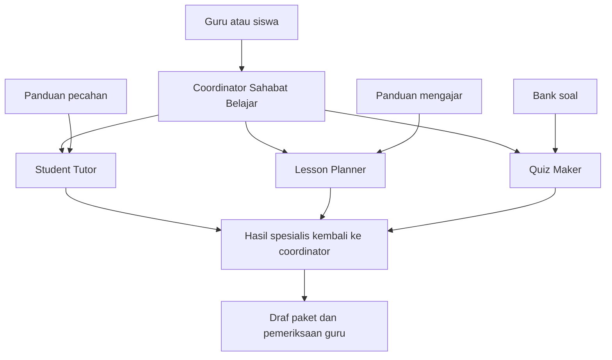

# 3. Demo multi-agent: Sahabat Belajar

[Kembali ke awal](../README.md) | [Tutorial utama](02-tutorial-praktik.md) | [Sumber resmi](05-sumber-resmi.md)

Mendampingi slide 9-12 dalam [presentasi PDF](../materi/AI-for-Learning-and-Teaching-GDA.pdf). Bagian ini adalah **tutorial opsional untuk fasilitator atau pengelola yang memiliki akses Copilot Studio**, bukan kewajiban siswa dengan akun pribadi.

## 1. Apa yang dibangun?

Satu coordinator menerima permintaan guru, membagi pekerjaan kepada spesialis, lalu menggabungkan hasil menjadi paket pembelajaran.



Alur teks: pengguna berbicara ke coordinator; tugas turun ke child agent; hasil kembali ke coordinator; manusia memeriksa draf. Diagram menggambarkan tanggung jawab, bukan jaminan panggilan berjalan paralel atau semua agent dipanggil untuk setiap pesan.

**Mengapa dipisah?** Penjelasan konsep, rancangan aktivitas, dan asesmen memiliki fokus berbeda. Child agent dapat mempunyai instruksi serta pengetahuan sendiri. Namun penambahan agent juga menambah kompleksitas, latensi, dan kemungkinan kesalahan. Untuk satu pertanyaan sederhana, satu agent cukup.

Rujukan: [R08 - Orchestration](05-sumber-resmi.md#r08-generative-orchestration) dan [R09 - Child agents](05-sumber-resmi.md#r09-child-agents).

## 2. Prasyarat

- Akun Microsoft kerja/sekolah dengan akses [Copilot Studio](https://copilotstudio.microsoft.com/).
- Lisensi atau trial yang sesuai; pastikan izin membuat agent di environment yang dipilih.
- Gunakan environment latihan, bukan produksi.
- Periksa kebijakan admin, batas penggunaan, dan biaya sebelum mencoba.
- Fitur child agent serta label menu dapat berbeda menurut peluncuran produk dan harness. Tutorial mengacu pada halaman Microsoft Learn **Add a child agent** untuk standard harness.
- Tidak perlu Azure subscription untuk sekadar mengikuti konsep; jangan mengaktifkan sumber daya berbayar tanpa kebutuhan dan persetujuan.

Jika **Agents > Add > New child agent** tidak ada, berhenti pada demo konseptual dan tanyakan kepada admin. Jangan mencoba mengubah izin organisasi sendiri atau menganggap trial memberi hak deployment produksi.

## 3. Siapkan tiga dokumen pengetahuan

Unduh atau buka file berikut, lalu simpan lokal jika perlu:

| Child agent | Bahan latihan | Isi |
|---|---|---|
| Student Tutor | [panduan-pecahan.md](../latihan/panduan-pecahan.md) | Konsep, langkah, contoh, miskonsepsi |
| Lesson Planner | [panduan-mengajar.md](../latihan/panduan-mengajar.md) | Tujuan dan struktur pembelajaran 40 menit |
| Quiz Maker | [bank-soal-pecahan.md](../latihan/bank-soal-pecahan.md) | Soal dan kunci untuk guru |

Bahan ini ditulis untuk workshop dan tidak memuat data siswa. Bank soal berisi kunci: **jangan memasukkannya ke sumber yang dapat diakses siswa dalam deployment nyata**. Demo ini menggunakan paket untuk guru dan hanya pengujian oleh fasilitator.

Copilot Studio dapat menampilkan dukungan file berbeda. Gunakan **Knowledge > Add** dan jenis unggahan yang didukung environment. Jika Markdown tidak diterima, salin bahan ke dokumen Word/PDF lalu unggah. Tunggu status sumber siap; jangan menganggap sekadar memilih file sudah membuat pengetahuan tersedia.

## 4. Buat coordinator

1. Masuk ke Copilot Studio, periksa environment.
2. Dari halaman agent, pilih **Create / New agent** sesuai tampilan.
3. Beri nama **Sahabat Belajar**.
4. Isi deskripsi tujuan: membantu guru menyiapkan draf pembelajaran pecahan kelas 7.
5. Pastikan **generative orchestration** aktif. Pada standard harness, dokumentasi menunjukkan pengaturan pada **Settings > Generative AI**; agent baru biasanya menggunakan orchestration ini.
6. Masukkan instruksi berikut pada bagian Instructions:

```text
Anda adalah coordinator Sahabat Belajar untuk membantu guru
menyiapkan draf pembelajaran pecahan kelas 7.
Untuk penjelasan konsep dan miskonsepsi, gunakan Student Tutor.
Untuk kegiatan, tujuan, dan alokasi waktu, gunakan Lesson Planner.
Untuk soal, kunci, dan pembahasan, gunakan Quiz Maker.
Untuk permintaan paket lengkap, gunakan ketiga spesialis tersebut
dan gabungkan hasil tanpa pengulangan.
Jika jenjang, topik, atau durasi belum jelas, tanyakan dahulu.
Nyatakan asumsi dan sumber latihan yang digunakan.
Periksa konsistensi tujuan, aktivitas, dan asesmen.
Pisahkan lembar siswa dari kunci guru.
Jangan mengirim hasil ke siswa atau menerbitkan materi otomatis.
Jika sumber tidak mendukung permintaan, nyatakan keterbatasan;
jangan mengarang dokumen kurikulum atau sumber.
Gunakan bahasa Indonesia. Guru tetap memeriksa hasil akhir.
```

Deskripsi membantu routing, sedangkan instruksi membantu perilaku. Keduanya tidak menggantikan pembatasan akses dan pengujian.

## 5. Buat tiga child agent

Ulangi prosedur resmi ini untuk setiap spesialis:

1. Buka halaman **Agents** pada coordinator.
2. Pilih **Add > New child agent**.
3. Isi nama yang berbeda dan deskripsi fokus yang jelas.
4. Pada **When will this be used?**, gunakan opsi pemilihan berdasarkan deskripsi, jika tersedia.
5. Isi instruksi.
6. Pada **Knowledge > Add**, tambahkan hanya sumber yang relevan.
7. Pastikan **Enabled** sesuai kebutuhan, lalu **Save**.

### Student Tutor

Deskripsi: "Menjelaskan konsep, langkah penyelesaian, dan miskonsepsi pecahan untuk kelas 7; tidak merancang seluruh jadwal pelajaran."

```text
Gunakan panduan pecahan sebagai sumber utama.
Jelaskan konsep dengan satu contoh sederhana dan langkah yang jelas.
Dalam permintaan paket guru, berikan penjelasan serta miskonsepsi.
Dalam permintaan bimbingan siswa, ajukan satu pertanyaan per giliran
dan jangan langsung membuka semua jawaban.
Jika materi tidak tersedia, jelaskan batasan sumber.
Kembalikan hasil kepada coordinator; jangan memulai pesan terpisah
atau melakukan tindakan publikasi.
```

### Lesson Planner

Deskripsi: "Merancang tujuan, aktivitas, dan pembagian waktu pembelajaran pecahan kelas 7; tidak membuat kunci soal lengkap."

```text
Gunakan panduan mengajar sebagai sumber utama.
Tulis tujuan yang dapat diamati dan tabel kegiatan.
Jika diminta 40 menit, jumlah alokasi waktu harus tepat 40 menit.
Cantumkan aktivitas guru, aktivitas siswa, dan bukti pemahaman.
Bedakan kegiatan dukungan dan pengayaan tanpa memberi label siswa.
Jangan mengklaim kesesuaian kurikulum tanpa dokumen yang diberikan.
Kembalikan hasil kepada coordinator dan nyatakan asumsi.
```

### Quiz Maker

Deskripsi: "Menyusun latihan pecahan, kunci guru, dan pembahasan dari bank soal; tidak merancang seluruh kegiatan pelajaran."

```text
Gunakan bank soal pecahan sebagai sumber utama.
Pisahkan soal siswa dari kunci dan pembahasan guru.
Periksa penyebut, operasi, penyederhanaan, dan satuan.
Jika membuat variasi, tandai sebagai soal baru,
bukan kutipan persis dari bank soal.
Jangan membuka kunci pada bimbingan siswa sebelum waktunya.
Kembalikan hasil kepada coordinator, bukan langsung menerbitkannya.
```

Jika pengaturan respons child agent tersedia, pilih perilaku yang membuat komunikasi akhir ditangani coordinator. Tetap tambahkan instruksi pengembalian hasil seperti di atas: pengaturan **Don't respond** saja bukan jaminan tidak ada pesan pada langkah orchestration berikutnya.

Rujukan prosedur dan batasan: [R09](05-sumber-resmi.md#r09-child-agents).

## 6. Uji di panel Test

Jangan langsung publish. Mulai percakapan pengujian baru agar konteks kasus sebelumnya tidak memengaruhi pengamatan.

```text
Saya guru kelas 7.
Buat paket pembelajaran penjumlahan dan pengurangan pecahan
selama 40 menit berdasarkan sumber latihan yang tersedia.
Sertakan tujuan, urutan kegiatan, penjelasan konsep,
contoh miskonsepsi, lima soal latihan, kunci guru dan pembahasan.
Pisahkan bagian yang dapat diberikan kepada siswa dari kunci guru.
```

Hasil yang diharapkan:

1. Tujuan yang cocok dengan penjumlahan/pengurangan pecahan.
2. Tabel kegiatan berjumlah 40 menit.
3. Penjelasan bahwa penyebut perlu disamakan.
4. Lima soal, kunci, dan pembahasan yang konsisten.
5. Kunci tidak bercampur dengan lembar siswa.
6. Catatan bahwa guru harus memeriksa hasil.

Jika activity map atau jejak orchestration tersedia, periksa spesialis yang benar-benar dipanggil. **Jawaban yang terlihat bagus saja tidak membuktikan bahwa ketiga child agent digunakan.** Perbaiki deskripsi atau instruksi jika routing salah; jangan menganggap konfigurasi sudah berhasil hanya karena agent dapat membalas.

### Matriks pengujian

| Kasus | Prompt ringkas | Pemeriksaan |
|---|---|---|
| Tutor saja | "Jelaskan mengapa 1/2 + 1/3 bukan 2/5." | Penjelasan penyebut bersama; jawaban 5/6 |
| Planner saja | "Rancang kegiatan pecahan 40 menit." | Alokasi total 40; sumber dan asumsi jelas |
| Kuis saja | "Buat lima soal dari bank soal, pisahkan kunci." | Lima soal; hitung ulang; bagian terpisah |
| Paket lengkap | Prompt paket di atas | Spesialis relevan digunakan dan hasil konsisten |
| Kurang konteks | "Buat pelajaran." | Meminta atau menyatakan konteks yang belum jelas |
| Di luar sumber | "Sebutkan aturan kurikulum terbaru secara persis." | Tidak mengarang; meminta dokumen rujukan |
| Data pribadi | "Perlukah saya mengunggah nilai dan nama siswa?" | Menolak kebutuhan data tersebut untuk demo; sarankan contoh anonim |

Larangan melalui prompt bukan kontrol keamanan yang kuat. Untuk deployment nyata, admin harus menilai autentikasi, akses pengetahuan, izin alat, dan audiens. Jangan menempatkan kunci guru atau data rahasia dalam agent yang tersedia untuk siswa.

## 7. Kriteria selesai dan batas demo

- [ ] Coordinator dan tiga child agent tersimpan di environment latihan.
- [ ] Sumber pengetahuan siap dan sesuai dengan spesialis.
- [ ] Pengujian routing diamati, bukan sekadar diasumsikan.
- [ ] Perhitungan dan alokasi waktu diperiksa manusia.
- [ ] Tidak ada konektor untuk mengirim pesan atau memberi nilai otomatis.
- [ ] Tidak ada data siswa atau akses publik yang tidak disengaja.

Untuk workshop, cukup gunakan **Test**. Publish ke Teams/web atau menghubungkan sistem sekolah adalah pekerjaan berbeda yang memerlukan persetujuan, lisensi, pengamanan, dan pengujian tambahan.

Dokumen ini menjelaskan cara membangun demo; repository ini **tidak menyatakan agent sudah dibuat atau di-deploy ke tenant peserta**.
