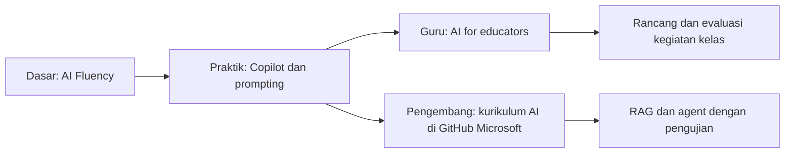

# 4. Program pendidikan dan peta belajar lanjutan

[Kembali ke awal](../README.md) | [Sumber resmi](05-sumber-resmi.md)

Mendampingi slide 29-35 dalam [presentasi PDF](../materi/AI-for-Learning-and-Teaching-GDA.pdf). Status dan tautan ditinjau pada **8 November 2026**. Halaman program resmi tetap menentukan persyaratan saat peserta mendaftar.

## 1. Bedakan arti "gratis"

| Bentuk penawaran | Artinya | Bukan berarti |
|---|---|---|
| Materi belajar gratis | Konten pelatihan dapat dibaca tanpa membayar kursus | Semua ujian sertifikasi gratis |
| Produk gratis untuk institusi eligible | Sekolah harus memenuhi syarat dan aktivasi | Semua orang otomatis mendapat semua fitur |
| Kredit cloud | Pemakaian dibatasi saldo, periode, dan ketentuan | Komputasi tanpa batas selamanya |
| Trial | Kesempatan mencoba dengan batas waktu/fitur | Lisensi produksi permanen |
| Kuota gratis | Pemakaian tertentu tersedia tanpa langganan | Semua generasi gambar atau AI tanpa batas |
| Kompetisi | Kesempatan mengikuti seleksi | Hadiah atau kredit pasti diterima semua pendaftar |

## 2. Untuk pengelola sekolah

### Office 365 A1 for Education

Microsoft menyediakan Office 365 A1 bagi institusi pendidikan yang memenuhi syarat. Layanan mencakup aplikasi web dan layanan kolaborasi pendidikan sesuai paket serta konfigurasi.

**Langkah praktis:**

1. Buka [Microsoft Education](https://www.microsoft.com/en-us/education).
2. Minta pengelola TI meninjau [perbandingan paket pendidikan](https://www.microsoft.com/en/education/products/microsoft-365/compare-microsoft-365-education-plans).
3. Periksa eligibility institusi, domain sekolah, verifikasi, dan proses aktivasi.
4. Tentukan kebijakan akun siswa, privasi, penyimpanan, dan pengaturan admin.
5. Uji layanan dengan kelompok kecil sebelum mengumumkannya ke semua kelas.

**Jangan menjanjikan:** aplikasi desktop penuh, Minecraft Education, Microsoft 365 Copilot berbayar, Copilot Studio, atau semua fitur AI tanpa lisensi tambahan. Jangan menyamakan Office 365 A1 dengan penawaran A1 lain yang namanya mirip. Rincian paket dan batas penyimpanan mengikuti dokumentasi terbaru.

Rujukan: [R10 - A1](05-sumber-resmi.md#r10-office-365-a1).

### Aksesibilitas dan alat pendukung belajar

Mulai dari kebutuhan: bantuan membaca, pencarian yang kritis, subtitle, atau penyampaian presentasi. Uji alat pendidikan dan aksesibilitas yang tersedia pada paket sekolah; jangan menganggap semuanya tersedia pada semua aplikasi atau perangkat.

Gunakan teks alternatif untuk gambar, heading yang benar, kontras yang cukup, dan caption video. Ajak pengguna dengan kebutuhan aksesibilitas mengevaluasi hasil; jangan hanya menebak kebutuhannya.

## 3. Untuk guru

### Microsoft Learn Educator Center dan AI for educators

Mulai dari [AI for educators](https://learn.microsoft.com/en-us/training/paths/ai-education/), learning path pemula dengan empat modul pada saat ditinjau. Isinya mencakup konsep AI, prompting, penggunaan bertanggung jawab, dan penerapan pembelajaran.

Langkah:

1. Masuk ke Microsoft Learn untuk mencatat progres pada profil.
2. Buka learning path, lalu modul pertama.
3. Baca unit secara berurutan dan coba latihan yang relevan.
4. Kerjakan assessment; jangan hanya mengejar tanda selesai.
5. Terapkan satu praktik di kelas, kemudian refleksikan dampaknya.

Sebagian modul membahas produk pendidikan dengan syarat akses tersendiri. Materi kursus yang gratis tidak otomatis memberi lisensi produknya.

Rujukan: [R02](05-sumber-resmi.md#r02-ai-for-educators).

### Microsoft Elevate for Educators

Program yang diumumkan Microsoft pada Januari 2026 ini menyediakan pengembangan profesional, komunitas, dan peluang credential untuk pendidik.

- Mulai melalui [Microsoft Elevate for Educators](https://aka.ms/MicrosoftElevateforEducators).
- Pilih materi atau komunitas yang sesuai peran.
- Baca syarat credential dan pendaftaran pada halaman aktif.
- Jangan menganggap gelar komunitas lama, jadwal seleksi tahunan, atau mekanisme pengakuan tetap sama.

Pengumuman peluncuran merupakan bukti program diperkenalkan, bukan jaminan jadwal pendaftaran atau setiap fitur masih sama saat workshop berikutnya.

Rujukan: [R11 - Elevate for Educators](05-sumber-resmi.md#r11-elevate-for-educators).

### Microsoft Learn for Educators / MSLE

[MSLE](https://learn.microsoft.com/en-us/training/educator-center/programs/msle/overview) menyediakan kurikulum dan dukungan bagi pendidik untuk mengajarkan keterampilan teknologi Microsoft. Program ini terutama relevan bagi perguruan tinggi dan pengajar STEM pendidikan menengah yang sesuai eligibility.

Baca overview, cocokkan kategori institusi/pengajar, dan ikuti proses partisipasi resmi. MSLE tidak sama dengan memberi setiap siswa akun cloud tanpa batas.

Rujukan: [R12 - MSLE](05-sumber-resmi.md#r12-microsoft-learn-for-educators).

## 4. Untuk siswa dan mahasiswa

### Microsoft Learn dan AI Fluency

[AI Fluency](https://learn.microsoft.com/en-us/training/paths/ai-fluency/) adalah jalur pemula dengan tujuh modul pada saat ditinjau. Mulai dari **Explore AI basics**, kemudian generative AI, pencarian, responsible AI, dan Copilot.

Konten dapat dipelajari gratis. Gunakan akun yang sesuai aturan usia untuk menyimpan progres jika tersedia. Progres atau badge modul tidak sama dengan sertifikat profesional yang diperoleh melalui ujian.

Rujukan: [R01](05-sumber-resmi.md#r01-ai-fluency).

### GitHub Student Developer Pack

Menurut GitHub Docs, peserta harus berusia setidaknya 13 tahun, memiliki akun GitHub pribadi, dan terdaftar dalam program yang memberi degree atau diploma serta dapat membuktikan status pelajar.

1. Buka [GitHub Education](https://github.com/education/students).
2. Masuk ke akun GitHub.
3. Buka **Education benefits > Start an application**.
4. Lengkapi verifikasi yang diminta, termasuk email akademik bila diwajibkan.
5. Tunggu persetujuan dan periksa benefit yang aktif.

Dokumen verifikasi mengandung data pribadi: unggah **hanya** melalui proses resmi GitHub, bukan repository workshop atau chat AI. Benefit mitra, kuota, nama paket, serta proses verifikasi ulang dapat berubah; tidak semua benefit aktif otomatis.

Rujukan: [R13 - GitHub Education](05-sumber-resmi.md#r13-github-education).

### Azure for Students

Penawaran menyediakan **USD100 kredit untuk 12 bulan** dan tidak memerlukan kartu kredit saat pendaftaran, menurut halaman penawaran resmi. Eligibility meliputi usia **18+**, mahasiswa penuh waktu pada institusi terakreditasi pemberi gelar dua/empat tahun, serta verifikasi status akademik.

Tidak tepat menjanjikan penawaran ini untuk semua siswa SMP/SMA.

1. Buka [Azure for Students](https://azure.microsoft.com/en-us/free/students/).
2. Baca [ketentuan penawaran](https://azure.microsoft.com/en-us/pricing/offers/ms-azr-0170p/).
3. Daftar dan lakukan verifikasi hanya melalui portal resmi.
4. Setelah aktif, pahami saldo, masa berlaku, dan layanan yang digunakan.
5. Buat sumber daya hanya jika benar-benar diperlukan untuk latihan.
6. Setelah latihan, hapus sumber daya yang dibuat dan tidak digunakan lagi.

Kredit bukan uang tunai. Ketika kredit/masa berlaku berakhir, layanan dapat dinonaktifkan kecuali pengguna memilih pengaturan penawaran lain. Jangan beralih ke pay-as-you-go tanpa memahami potensi biaya. Tiga demo dasar workshop tidak membutuhkan akun Azure.

Rujukan: [R14 - Azure for Students](05-sumber-resmi.md#r14-azure-for-students).

### Microsoft Applied Skills

[Applied Skills](https://learn.microsoft.com/en-us/credentials/applied-skills/) menggunakan asesmen tugas praktis berbasis lab untuk membuktikan kemampuan tertentu. Ini berbeda dari sekadar menyelesaikan learning path.

Pilih credential, pelajari prasyarat, latihan, lalu baca mekanisme dan ketentuan assessment terkini. Periksa apakah alat latihan terpisah memerlukan akun atau lisensi. Jangan menyamakan Applied Skills dengan semua ujian sertifikasi Microsoft.

Rujukan: [R15 - Applied Skills](05-sumber-resmi.md#r15-applied-skills).

### Imagine Cup

Pada saat ditinjau, situs menampilkan **Imagine Cup 2027**, kompetisi berorientasi startup, termasuk kategori **Student startup**. Situs menyebut penutupan aplikasi **28 Februari 2027** dan hadiah Top Student Startup berupa USD25.000 serta USD250.000 startup credits.

Angka ini adalah **hadiah pemenang yang memenuhi syarat**, bukan benefit semua pelajar. Baca official rules untuk syarat usia, status startup, kategori, teknologi, serta jadwal; jangan menganggap kompetisi ini cocok untuk semua peserta sekolah.

Langkah awal: buka [Imagine Cup](https://imaginecup.microsoft.com/), baca aturan edisi aktif, lalu diskusikan kelayakan tim dengan mentor. Jangan membagikan ide sensitif atau dokumen identitas di repository publik.

Rujukan: [R16 - Imagine Cup](05-sumber-resmi.md#r16-imagine-cup).

## 5. Microsoft Elevate Indonesia

Microsoft News menjelaskan program peningkatan keterampilan AI di Indonesia bersama mitra. Gunakan pengumuman resmi sebagai konteks, lalu cari kanal pendaftaran aktif. Target jumlah peserta dalam berita adalah target program, bukan jaminan bahwa setiap peserta mendapat sertifikasi.

Untuk guru, fokus pada pelatihan yang membantu penerapan di kelas. Periksa penyelenggara, periode, dan syarat setiap kegiatan; hindari halaman tidak resmi yang meminta pembayaran atau informasi sensitif tanpa kejelasan.

Rujukan: [R17 - Elevate Indonesia](05-sumber-resmi.md#r17-elevate-indonesia).

## 6. Peta belajar dari pemula ke pengembang

Untuk peserta yang ingin membuat solusi teknis, gunakan kurikulum resmi di organisasi GitHub Microsoft:

- [AI for Beginners](https://github.com/microsoft/AI-For-Beginners)
- [ML for Beginners](https://github.com/microsoft/ML-For-Beginners)
- [Generative AI for Beginners](https://github.com/microsoft/generative-ai-for-beginners)

Baca README dan prasyarat masing-masing. Konten belajar gratis tidak menjamin layanan komputasi/model untuk menjalankan semua latihan gratis. Jangan menempel API key ke repository.

## 7. Rencana tujuh hari setelah workshop

| Hari | Siswa | Guru |
|---|---|---|
| 1 | Mulai Explore AI basics | Mulai AI for educators |
| 2 | Tulis tiga prompt dengan empat unsur | Perbaiki satu prompt perencanaan |
| 3 | Latihan konsep dengan petunjuk, bukan jawaban | Buat draf aktivitas dan periksa waktunya |
| 4 | Buat kartu belajar dan cek faktanya | Buat soal dan hitung ulang semua kunci |
| 5 | Buat poster nonkomersial dan revisi judul | Evaluasi aksesibilitas satu bahan ajar |
| 6 | Diskusikan satu kesalahan AI | Coba diferensiasi tanpa data pribadi |
| 7 | Tulis refleksi dan pernyataan bantuan AI | Bagikan praktik yang sudah ditinjau kepada rekan |

**Keberhasilan:** peserta dapat menjelaskan apa yang AI bantu, apa yang diperiksa, apa yang masih terbatas, dan siapa yang bertanggung jawab. Bukan sekadar berapa banyak konten dihasilkan.
